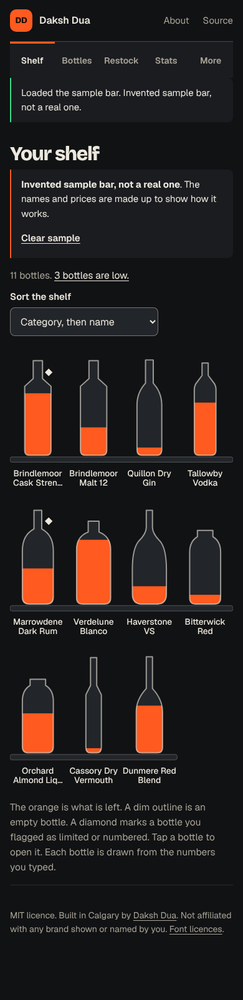
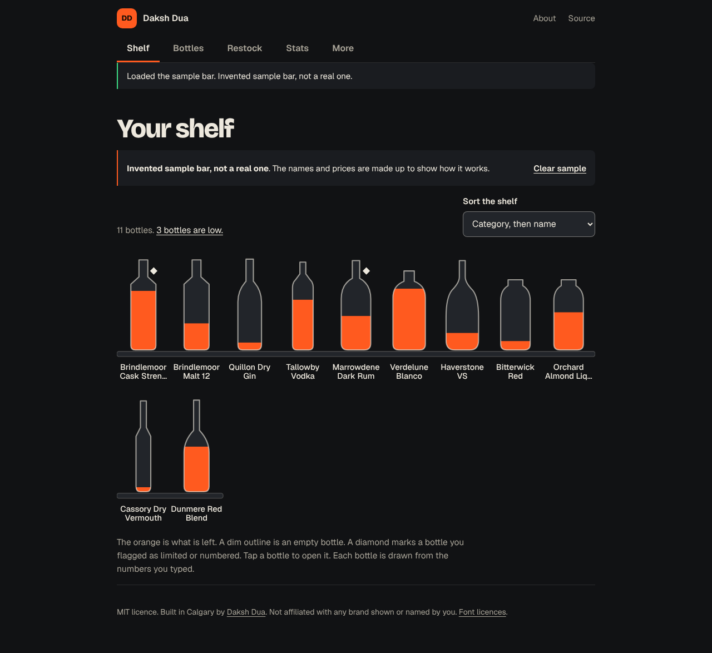

# Bar Vault

**A home bar ledger for your phone: what is on the shelf, how much is left, what each peg cost, what is low. Nothing leaves your device.**

[**Try it live**](https://daksh2197.github.io/bar-vault/). Free, no account, works with no signal.

[](https://github.com/daksh2197/bar-vault/actions/workflows/ship.yml)
[](LICENSE)

<p align="center">
  
</p>

The screenshot shows an invented sample bar. Every name and price in it is made up.

## Why I built it

I wanted a "my bar" board on my phone. A picture of the shelf that shows what is on it, what each peg cost, which bottles are limited editions by my own tag, and what is running low. And a plain export I can wire into voice routines myself, by hand, without an app talking to a speaker on my behalf.

The usual way to do this is a spreadsheet, and a spreadsheet does not look like a shelf. So the shelf is the screen, and the numbers sit under it.

## What it does

- **Draws your shelf.** One bottle shape per category (whisky, gin, vodka, rum, tequila, brandy, liqueur, vermouth, wine, other). The orange inside is how full it is. An empty bottle is a dim outline. Tap one to open it.
- **Works out what is left.** For every bottle: millilitres left, whole pegs left, price per peg, and the value left. You set the peg size (30, 45 or 60 ml, or anything from 5 to 500).
- **Keeps the rarity as your tag.** Common, limited, numbered, allocated, discontinued or unknown, plus a limited-or-numbered flag and a free-text bottle number such as "214 of 1,000". A small diamond marks a flagged bottle on the shelf.
- **Never fetches a price.** There is no price feed and no lookup. A reference price is three fields you type: amount, where you saw it, the date. No figure in the app uses it. The watchlist is a flag ("Watch this bottle") and a note you write yourself.
- **Shows what is low.** Each bottle has its own low line, 20 percent unless you change it. The Restock screen lists the low ones and your watchlist, and makes a shopping list as text or CSV.
- **Counts the bar.** Bottles, how many are low, total paid, value left, average and median price per peg, a histogram of price per peg, and paid by category. A gift entered as $0.00 is left out of the per-peg figures.
- **Makes a file for voice routines.** A small JSON file (`bar-vault-smart-home/1`) and a one-line summary such as "3 bottles low: SAMPLE Cassory Dry Vermouth, SAMPLE Quillon Dry Gin, SAMPLE Bitterwick Red." It does not connect to Alexa, Google Home or Apple Home. You carry it across by hand. The three guides cite the vendor pages they rely on, and I did not run the steps on a real device.
- **Backs up to a file.** Plain JSON, or locked with a passphrase (AES-GCM, key from PBKDF2). Photos are optional, up to 10 MB. Importing merges: when the same bottle is in both, the newer edit wins and nothing is deleted, not even a saved row the app cannot read. An edit dated after the moment of import counts as made at that moment, so a future date cannot win every merge. Settings are not in the file.
- **Keeps photos on the device.** A photo is shrunk to 640 px on its longest side, saved as a JPEG in the browser's database, and never uploaded.
- **Ships an invented sample bar.** Eleven made-up bottles, labelled "Invented sample bar, not a real one" wherever they show. One tap clears them.
- **Says who it is for.** The About page reads: "For adults of legal drinking age where you live (18 in Alberta). This app records what you own. It gives no drinking advice."
- **Works with no signal and keeps data on the device.** A service worker saves the app after the first visit. The app makes no requests, and the Content-Security-Policy in the built page blocks fetch, XHR and outside images. The only way data goes anywhere is a file you save.



## The hard part in 30 seconds

```
ml left       = round-half-up(size x fill% / 100)
pegs left     = floor(ml left / peg size)
price per peg = round-half-up(paid cents x peg ml / size ml)
```

Volume is whole millilitres. Money is whole cents. Every division goes through a bigint and rounds halves up, so nothing is NaN, nothing is negative, and no float crumb gets into a price.

A worked case: a 750 ml bottle that cost $45.00, with a 30 ml peg. That is 4,500 cents. 4,500 x 30 / 750 = 180 cents a peg, and 750 / 30 = 25 pegs. $1.80 a peg, 25 pegs. That case is a test.

The long version, with the rounding rule, the histogram buckets and the edge cases, is in [docs/THE-PEG-MATH.md](docs/THE-PEG-MATH.md). The storage layer (IndexedDB, migrations, the locked backup file) is the one from [Coin Vault](https://github.com/daksh2197/coin-vault), explained in its [THE-DATABASE.md](https://github.com/daksh2197/coin-vault/blob/main/docs/THE-DATABASE.md). Bar Vault reuses it and adds a photos store.

## Run it yourself

You need [Node.js](https://nodejs.org) 22.12 or newer.

```bash
git clone https://github.com/daksh2197/bar-vault.git
cd bar-vault
npm ci
npm run dev     # the app, live-reloading, at the address Vite prints
npm test        # 543 tests in 20 files, about ten seconds
npm run build   # typecheck, then the finished site in dist/
```

## How it's built

| Piece | Job | Why this one |
| --- | --- | --- |
| TypeScript (strict) | The language | It catches millilitres passed where cents go before the app runs |
| Vite 8 | Builds the site | One command, about 130 ms here |
| Vitest 5, fast-check, fake-indexeddb | Tests | Property tests for the maths, and the database tests run in Node against a stand-in |
| IndexedDB, used directly | The database | Three small stores (bottles, photos, meta) fit in one short file |
| WebCrypto | Passphrase locking | Built into every browser, so there is no crypto library to trust |
| Hand-written SVG | The shelf and the histogram | Ten outlines and some rectangles. No chart library, and the app's JavaScript is about 26 kB compressed |
| No framework | The screen | Forms, lists and one drawing. Logic stays out of the view |
| Service worker | Offline | Saves the app on the device the first time it opens |
| GitHub Actions and Pages | Test, then deploy | A failing test blocks the release. Hosting is free |

```
src/
  core/                 the brain: no screen, no network
    peg.ts              peg maths: ml left, pegs, price per peg, value left, low. Start here.
    stats.ts            totals, mean, median, the histogram buckets
    restock.ts          the low list, the watchlist, the shopping list as text and CSV
    exports.ts          the whole-bar CSV and the smart-home JSON and summary
    list.ts             search and sort for the bottle list and the shelf
    types.ts            Bottle, Settings, Photo, the categories and rarity tags
    schema.ts           what a valid bottle, setting or photo is
    form.ts             typed form text to a checked bottle, one message per field
    decimal.ts          typed text to exact decimals, and the half-up division
    money.ts            cents, whole-number parsing, money text
    dates.ts            real dates, today, ages
    db.ts               IndexedDB and its two migrations
    vaultfile.ts        export, import and merge of the backup file
    lock.ts             passphrase locking and unlocking
    photo.ts            shrink to 640 px, size checks, the backup cap, base64
    sample.ts           the eleven invented bottles
    fixtures.ts         shared by the tests: a bottle and a random-bottle generator
    *.test.ts           the tests, next to the code they check
  ui/
    shelf.ts            draws the shelf as SVG from the ledger
    silhouettes.ts      one outline per category, and where the liquid starts
    screens.ts          shelf, list, restock, stats, more, settings, about
    bottle-form.ts      the add and edit form
    backup-screen.ts    save, lock, restore, merge
    smarthome.ts        the Smart home page
    smarthome-copy.ts   its words and cited sources, kept as data so a test can read them
    words.ts            sentences that depend on numbers and dates
    route.ts            the hash address to a screen
    parts.ts            copy and download buttons, headings, the fill bar
    dom.ts              small helpers; text goes in as text, never as markup
    ctx.ts              what every screen is handed
    *.test.ts           route, shelf, smart-home copy and words tests
  main.ts               wires the database, the address and the screen
  hygiene.test.ts       rules for the whole repo (no network calls, no markup from user text)
  styles/               brand.css, fonts.css, app.css
public/sw.js            the offline worker
scripts/stamp-sw.mjs    stamps each build with a version
.github/workflows/ship.yml  test, then deploy
docs/                   CTO-NOTES.md, THE-PEG-MATH.md, SMART-HOME.md, BUSINESS.md
specs/bar-vault.md      the spec this was built from
```

Want the guided tour? [docs/CTO-NOTES.md](docs/CTO-NOTES.md) explains the ideas in plain English, how to debug them, and five changes to try. The money side is in [docs/BUSINESS.md](docs/BUSINESS.md). The voice-assistant research is in [docs/SMART-HOME.md](docs/SMART-HOME.md).

## What got caught along the way

- **A price limit two layers disagreed on.** The schema allows a bottle price up to exactly $10,000,000,000.00. The add form refused that number and stopped at $9,999,999,999.99, because its digit limit was one too small. A test that pushed the schema's largest value through the form found it. The two now agree.
- **A reference price of $0.00 that only one side refused.** The schema accepted a typed market reference of zero. The form did not. A file could carry a row that the edit form would then refuse to save. The schema now needs at least one cent.
- **Shelf labels sitting on the plank.** Long bottle names ran into the shelf board under the bottle. Names now wrap to two lines of at most 11 characters, and a second line that is still too long ends in an ellipsis.
- **A label on top of a count.** On the price histogram a label at the top overlapped a bar's count. The plot now keeps room above the bars.
- **A tab bar wider than the page.** On a desktop the tab bar ran wider than the column the page sits in. It is capped at the page width from 768 px up.

A test cannot see overlap or width, so the last three came from looking at the build in a browser.

An independent review, by a second agent that had not seen the build, then found three more:

- **An import that deleted rows it could not read.** Import rebuilt both stores from the rows the screen could parse, so a saved row the sanitiser rejected, and its photo, vanished on the next import, while the page said nothing is deleted. Import now writes only the rows it merged and clears nothing. A test keeps an unreadable row alive through an import.
- **A spreadsheet formula hiding in a CSV.** A bottle named `=HYPERLINK(...)` went into the shopping list CSV as is, and a spreadsheet would run it. Fields that start with `=`, `+`, `-`, `@`, a tab or a return now get a leading quote. A property test checks that no exported field starts with one.
- **A skip link that opened "Page not found".** The keyboard shortcut to the content pointed at `#app`, and the hash router read that as a screen name. Hashes that do not start with `#/` are now page jumps.

## How this was built

I build with Claude as my pair programmer. I bring the problem and decide what the thing should do. Claude writes most of the code. I review it until I can explain every file, and [the CTO notes](docs/CTO-NOTES.md) are my study guide, in public. Every commit carries the co-author line.

## Data, sources and limits

- **Legal drinking age.** 18 in Alberta, Manitoba and Quebec, per Wikipedia, ["Alcoholic drinks in Canada"](https://en.wikipedia.org/wiki/Alcoholic_drinks_in_Canada). Fetched October 23, 2026.
- **Voice assistants.** Alexa, Google Home and Apple Shortcuts are quoted from their vendor help pages, each with its URL and the fetch date of October 23, 2026, in [docs/SMART-HOME.md](docs/SMART-HOME.md). Amazon's pages were reached through an Amazon-hosted copy of the Alexa help (digprjsurvey.amazon.com), fetched Oct 23, 2026. Anything those pages do not say is marked "not documented on the pages fetched".
- **Prices.** There is no price feed. Every price is one you typed.
- **Storage, lock and form code.** Adapted from [Coin Vault](https://github.com/daksh2197/coin-vault) (MIT, same author). Each adapted file says so in its first line.
- **Fonts.** Bricolage Grotesque, Geist and Geist Mono ship inside the app under the SIL Open Font License 1.1. The notices are in [public/THIRD-PARTY-NOTICES.txt](public/THIRD-PARTY-NOTICES.txt).
- **Sample data** is invented. No bottle name in the sample or on a screen is a real brand, and a test checks that.
- **Not financial advice.** Value left is what you paid, scaled by how much is left. It is not a valuation or an appraisal.
- **Not affiliated** with any liquor brand, store, Amazon, Google or Apple.

## What's next

- [ ] Photos from a real phone camera. Photo shrinking is tested with a stand-in, and I have not tried a 5 MB camera shot on a phone.
- [ ] Time the passphrase lock (600,000 rounds of PBKDF2) on a phone. The tests run it in Node.
- [ ] Run the Alexa, Google Home and Shortcuts steps on a real device. They are written from vendor pages and not run.
- [ ] Put the settings (peg size, default low line) in the backup file. Today they stay on the device.

Ideas and pull requests are welcome.

## License

[MIT](LICENSE). Use it, fork it, keep your own bar in it.

Built in Calgary by [Daksh Dua](https://dakshdua.ca).
